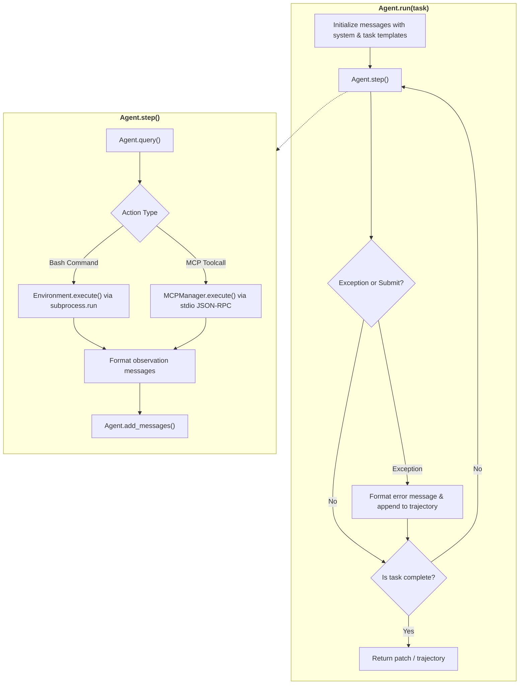

# Agent Control Flow

This document details the internal architecture and execution loop of Peen-SWE.

---

## The Execution Loop

Peen-SWE is built on a minimal, linear execution loop. Unlike traditional agents that manage opaque internal states and complex decision graphs, Peen-SWE reduces agent interaction to three transparent primitives:

1. **Query**: The model is prompted with the full append-only message trajectory.
2. **Action Execution**: The model's proposed commands are routed to either the stateless shell environment (`subprocess.run`) or to an active Model Context Protocol (MCP) server.
3. **Observation**: Output strings or JSON-RPC tool responses are formatted and appended to the message trajectory.



---

## Core Implementation

The entire core execution loop is implemented in under 100 lines of standard Python:

```python
def step(self) -> list[dict]:
    """Single execution step: query model and execute actions."""
    return self.execute_actions(self.query())
```

### 1. `query()`
Validates call and cost limits before querying the model:
```python
def query(self) -> dict:
    if self.step_limit and self.n_steps >= self.step_limit:
        raise LimitsExceeded(f"Step limit reached: {self.step_limit}")
    message = self.model.query(self.messages)
    self.add_messages(message)
    return message
```

### 2. `execute_actions()`
Dispatches actions depending on whether they are shell commands or MCP tool calls:
```python
def execute_actions(self, message: dict) -> list[dict]:
    outputs = []
    for action in self.get_actions(message):
        if self.mcp_manager and self.mcp_manager.is_mcp_tool(action["tool_name"]):
            outputs.append(self.mcp_manager.execute(action))
        else:
            outputs.append(self.env.execute(action))
    return self.add_messages(*self.model.format_observation_messages(outputs))
```

---

## Why Stateless Execution?

Traditional AI software agents often maintain an interactive shell session (e.g. via `pexpect` or PTY pseudo-terminals) across multiple turns. In practice, this introduces critical points of failure:
- **Hangs on interactive prompts**: If a command prompts `(y/n)` or enters a pager (`less`), the agent blocks indefinitely.
- **State contamination**: Unclosed environment variables or directory changes corrupt subsequent steps.
- **Session termination**: Segfaults or shell crashes terminate the entire agent process.

Peen-SWE executes every shell action via an isolated `subprocess.run` invocation with deterministic timeouts and captured streams (`stdout` and `stderr`). Working directories and environment variables are explicitly passed per execution.

---

## Source Code Reference

- **Interactive Agent**: [`peen.agents.interactive`](../reference/agents/interactive.md)
- **Default Agent**: [`peen.agents.default`](../reference/agents/default.md)
- **Local Environment**: [`peen.environments.local`](../reference/environments/local.md)
- **MCP Manager**: `peen.mcp.manager.MCPManager`


